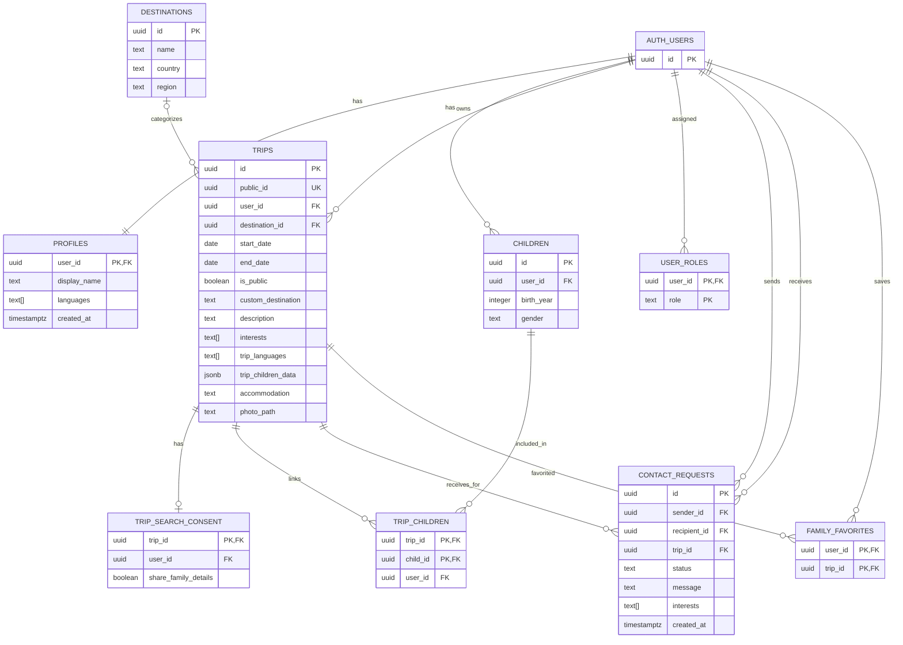

# Holiday Match — Project Documentation

## Project overview

Holiday Match (branded as Holiday Buddies in the interface) helps parents find other families travelling to the same destination during overlapping dates. Parents can compare shared languages and children's approximate ages, save trips, and contact another parent about a shared holiday.

The application is for parents: children do not have accounts and do not communicate through the app. A family can register and sign in, manage its profile and trips, decide whether trip details may appear in public search, search eligible trips, save favorites, and send or respond to parent-to-parent contact requests. Contact replies and notifications are not currently implemented.

## Architecture and technologies

This is a browser-based single-page application with a hosted Supabase backend:

| Layer | Technology | Purpose |
|---|---|---|
| User interface | HTML, CSS, vanilla JavaScript ES modules | Responsive client-rendered pages and interactions |
| UI framework and icons | Bootstrap 5, Bootstrap Icons | Layout, controls, and iconography |
| Build and local server | Vite, npm | Development server and production asset bundling |
| Authentication | Supabase Auth | Parent registration, sign-in, and session management |
| Database and backend APIs | Supabase, PostgreSQL | Persistent application data, Row Level Security (RLS), and database RPC functions |
| Trip images | Supabase Storage | Private `trip-images` bucket with access controlled by ownership and trip sharing |
| Hosting | Netlify | Serves the built `dist` application; history fallback supports direct app routes |

The frontend uses `@supabase/supabase-js` directly with the public publishable key. Authorization is enforced by database RLS and narrowly scoped RPC functions; the frontend must never contain a Supabase service-role key. Public search RPCs return only opted-in trip information, not parent names, email addresses, or internal user IDs. Exact destination and dates can still be identifying when combined with other information, so sharing requires informed consent.

The application currently provides landing, login/registration, family search, and trips experiences. Navigation and parts of the interface are translated into German, English, and Bulgarian; translations are incomplete.

## Database schema

The diagram shows the main application tables and their relationships. `auth.users` is managed by Supabase Auth. Trip photo files live in Supabase Storage rather than in a PostgreSQL table.



### Schema notes

- A profile belongs to one Auth user. Child profile records and the `trip_children` join table are retained for age/birth-year-based trip data.
- Trips have a stable internal `id` and a separate random `public_id` used as the public reference. A trip can use a catalog destination or a custom destination. Current trip forms store trip-specific ages and genders in `trip_children_data` and languages in `trip_languages`.
- `is_public` and the per-trip `trip_search_consent.share_family_details` flag both gate public family search. New trips default to private; publishing or unpublishing updates visibility and consent through `set_trip_visibility`.
- Contact requests are linked to the recipient's trip and track sender, recipient, status, message, and selected interests. Favorites form a private user-to-trip association.
- `user_roles` supports `user` and `admin` roles. RLS policies restrict access to user-owned records and reserve administrative operations for admins.
- Schema changes are captured in timestamped SQL migrations in `supabase/migrations/`. Public search and contact behavior is also implemented through PostgreSQL RPC functions.

## Local development setup

### Prerequisites

- Node.js compatible with Vite 7 and npm.
- A Supabase project for local development.

### Setup

1. Install the project dependencies from the repository root:

   ```sh
   npm install
   ```

2. Create a Supabase project. Apply the timestamped SQL files in `supabase/migrations/` in filename order using the Supabase SQL Editor (or a separately configured Supabase CLI workflow). The repository does not include a Supabase CLI configuration.

3. Configure Supabase Auth's site URL and allowed redirect URLs for the local app, including the `/login` email-confirmation redirect.

4. Create a local environment file from the example:

   ```powershell
   Copy-Item .env.example .env
   ```

   Set the project's URL and public publishable key:

   ```dotenv
   VITE_SUPABASE_URL=https://<project-ref>.supabase.co
   VITE_SUPABASE_PUBLISHABLE_KEY=<publishable-key>
   ```

   `WIKIMEDIA_CONTACT_EMAIL` is an optional contact address for Wikimedia Commons image requests. Never put a service-role key in a `VITE_` variable or browser code.

5. Start the Vite development server:

   ```sh
   npm run dev
   ```

   Open the local URL printed by Vite. Supabase Auth email confirmation and delivery depend on the project's Auth and SMTP settings.

### Available npm scripts

| Command | Description |
|---|---|
| `npm run dev` | Start the Vite development server |
| `npm run build` | Create the production build in `dist/` |
| `npm run preview` | Preview the production build locally |
| `npm run seed:dev` | Seed demo data in a specifically confirmed development Supabase project; see the script's required environment safeguards before use |

Unit tests are present alongside modules as `*.test.js` files. There is no `test` script in `package.json`.

## Key folders and files

| Path | Purpose |
|---|---|
| `src/main.js` | Main application entry point, page rendering, navigation, and event handling |
| `src/lib/` | Feature modules for authentication, trips, family search, destinations, contacts, images, pagination, and translations; corresponding unit tests are colocated |
| `src/data/` | Local/demo data used by the frontend |
| `src/assets/` | Images, fonts, and other imported visual assets |
| `src/styles.css` | Application-specific styles |
| `public/` | Static files copied to the build output, including the Netlify route fallback |
| `scripts/` | Development utilities and their tests, including demo data seeding |
| `supabase/migrations/` | PostgreSQL schema, RLS policy, function, and Storage migrations |
| `.github/github_instructions.md` | Repository-specific contributor and Copilot guidance |
| `index.html` | HTML shell loaded by the Vite application |
| `package.json` / `package-lock.json` | npm scripts and pinned dependency versions |
| `.env.example` | Names of supported frontend environment variables; copy to an untracked `.env` for local configuration |
| `netlify.toml` | Netlify build command and publish directory |
| `README.md` | Project-specific Supabase, privacy, and deployment notes |
| `dist/` | Generated production build output; do not edit by hand |
